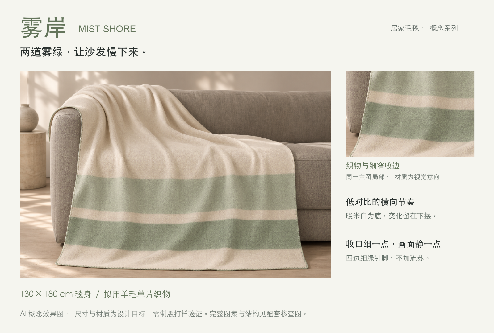
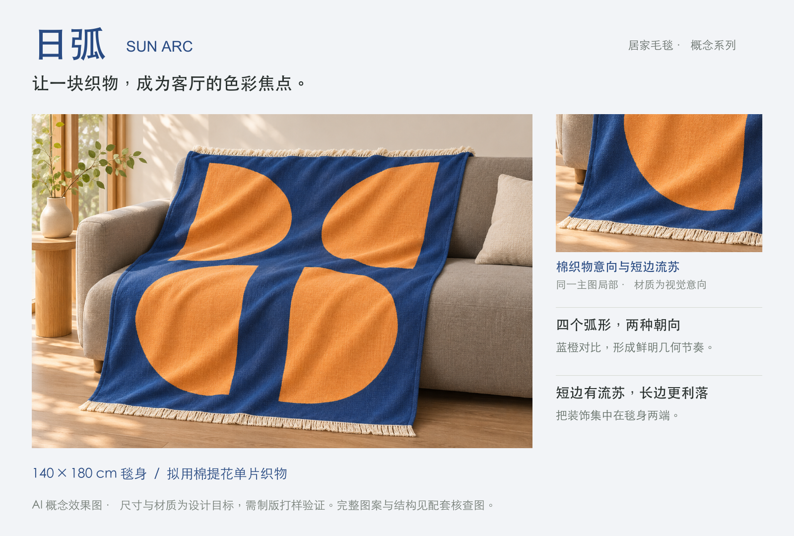
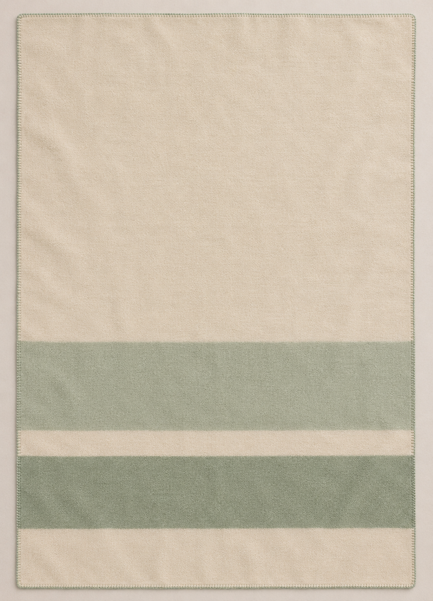
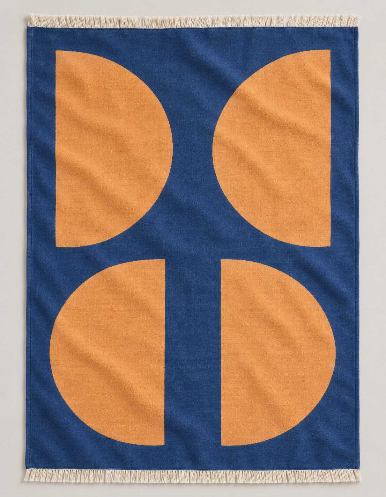
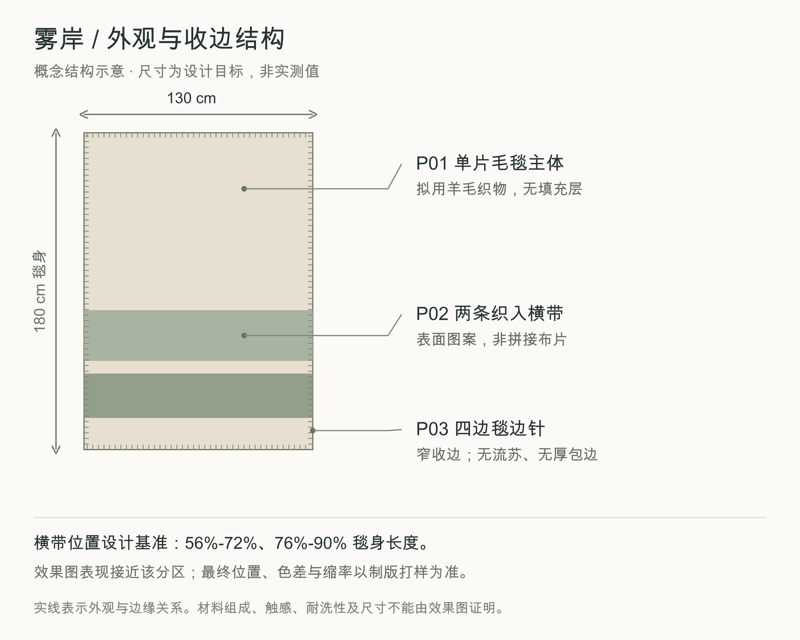
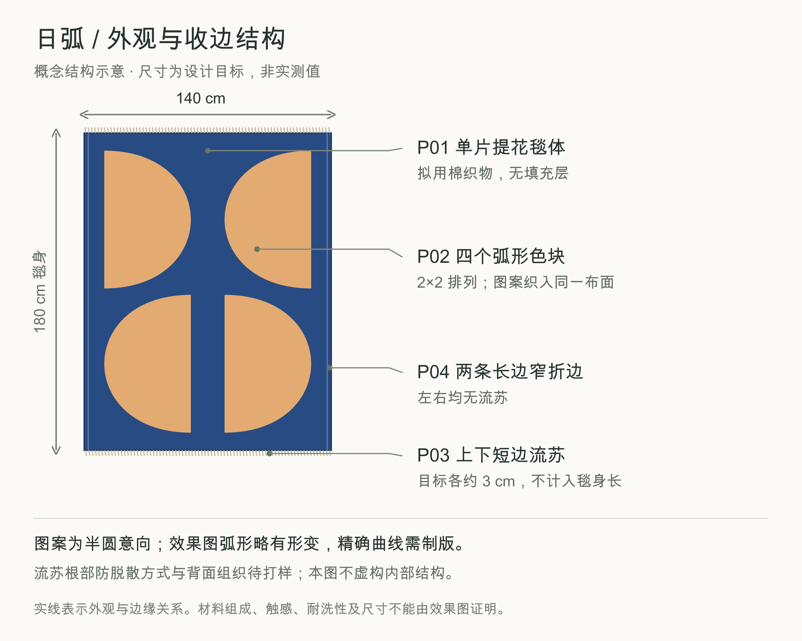

# 有品位的产品设计 · Tasteful Product Design

一个供 Codex 与 Claude Code 使用的中文 Agent Skill：每款产品研究 **2 款真实竞品**，推导设计语言和艺术方向，筛选构成、制作效果图，分别复核审美与结构，再输出简单结构图和品牌展示。

它把审美判断连接到产品用途和结构依据，适合概念设计、产品改版与方案讨论。默认展示偏向 **电商品牌感：场景氛围、材质细节、卖点明确**，产品风格按项目决定。支持实体与数字产品；只做评审或排版时，按请求使用相关步骤。

<a id="blanket-case"></a>

## 实际案例：雾岸与日弧

同一条需求，两种不同的毛毯设计方向。这个案例在 Codex 中使用本 Skill 完成：每款各研究 **2 款真实竞品**，推导艺术方向，生成效果图，检查外观结构一致性，再绘制对应的简单结构图。

> 示例需求：用这个 Skill 设计两款成人居家毛毯，用于沙发披盖与午睡。

### 品牌展示：场景、细节与设计特点

本次展示升级保留两款毛毯的图案与收边设计，重新制作场景主图，并用可控排版组织局部细节、设计特点和规格。它改善的是图像表达与展示层级，原有平铺图仍用于核查完整图案。



**雾岸：**暖米白与两道雾绿，变化集中在下摆；四边细窄针脚、无流苏。



**日弧：**钴蓝与杏橙形成视觉焦点；四个弧形交替朝向，短边流苏与利落长边形成对比。

[下载两页品牌展示 PDF](examples/blanket-designs/brand-presentation/brand-showcase.pdf) · [查看展示升级与核查记录](examples/blanket-designs/brand-presentation/presentation-review.md)

### 平铺核查视图与设计依据

| 雾岸 · Mist Shore | 日弧 · Sun Arc |
| --- | --- |
|  |  |
| **安静的织物肌理**：暖米白与雾绿横带，强调低对比节奏。 | **鲜明的几何节奏**：蓝橙对比与交替朝向的弧形，让毛毯成为空间焦点。 |
| 设计目标：130 × 180 cm，羊毛单片织物，四边毯边针、无流苏。 | 设计目标：140 × 180 cm，棉提花单片织物，仅短边留流苏、长边窄折边。 |
| 竞品：[Muuto Rhythm](https://professionals.muuto.com/product/Rhythm-Throw)、[Frette Zaira](https://eu.frette.com/en_IT/zaira-throw-taupe.html)。 | 竞品：[Slowdown Studio Pierre](https://slowdownstudio.com/collections/all/products/pierre-throw)、[Wallace Sewell Erno](https://wallacesewell.com/products/erno-throw)。 |

### 核查后的简单结构图

| 雾岸：毯体、横带与四边收口 | 日弧：毯体、图形、流苏与长边 |
| --- | --- |
|  |  |
| [查看可编辑 SVG](examples/blanket-designs/concept-a-structure.svg) | [查看可编辑 SVG](examples/blanket-designs/concept-b-structure.svg) |

**核查内容：**雾岸的两条全宽横带与连续窄针脚；日弧的四个弧形色块、朝向和仅在短边出现的流苏。结构图的编号与关系对应实际成图。

这些图片是 **AI 概念效果图**，不是实物照片。尺寸与材质是设计目标；本轮检查覆盖可见的外观一致性，场景中被遮挡的边缘、背面、精确曲线、真实纤维、尺寸和耐洗性仍需制版与打样。局部细节来自同一主图，不作为新增工艺证据。本案例展示 Codex 中的实际产出，不代表已经完成 Claude Code 的同流程实测。

[查看完整案例与来源](examples/blanket-designs/design-brief.md) · [下载五页 PDF 提案](examples/blanket-designs/blanket-design-proposals.pdf) · [雾岸生图提示词](examples/blanket-designs/concept-a-prompt.txt) · [日弧生图提示词](examples/blanket-designs/concept-b-prompt.txt)

## 工作流程


完整设计按上述流程进行。常规审美与结构修正共用最多两轮的预算；仍有关键问题时保留待验证标记，交付当前状态。结构图发现冲突时同步修正相应成果。用户可以指定不同预算。

## 每款产品会得到什么

- **竞品对比表：**恰好两款竞品，带品牌或型号、来源链接、访问日期和设计启示。
- **艺术风格方向：**解释为何匹配，以及如何落实到形态、比例、色彩、材质或界面语言；必要时比较低成本构成草案后深化。
- **效果图：**主视觉、完整核查视图与必要细节，数量依任务决定。
- **审美与结构复核记录：**分别记录实际观察、修正内容和待验证项。
- **简单结构图：**与最终效果图使用一致的编号、名称和关系。
- **品牌展示：**以主图、细节和有依据的特点建立层级，附完整分析入口。

局部请求只交付相关内容。同一需求的多个方案可以复用适用的竞品证据，但各自说明设计取舍。

实体产品检查部件、连接、比例和操作空间；数字产品检查区域、信息、动作和页面关系。效果图不能证明不可见的内部结构或未运行的交互。没有工程资料时，实体产品的成果属于概念设计与结构一致性检查，不是生产工程图。

## 需要什么工具

Skill 本体是 Markdown 文件，无需部署服务器，也没有必须安装的脚本依赖。执行完整流程时，宿主环境需要以下能力：

| 能力 | 用途 | 缺少时的行为 |
| --- | --- | --- |
| 搜索或浏览网页 | 核实两款竞品及艺术参考 | 使用用户提供的可靠资料；不足处标为证据缺口 |
| 图像生成、图像编辑或产品渲染 | 制作实际效果图 | 交付制作说明，明确效果图尚未生成 |
| 查看图片 | 检查真实生成结果 | 不声称完成视觉与结构检查 |
| 绘图或文件生成 | 输出简明结构图 | 根据环境选择 SVG、Mermaid 或可用绘图工具 |

Codex 与 Claude Code 共用同一份指令。**安装 Skill 不会自动给软件增加生图、搜索或 CAD 能力**；这些能力来自各自环境已经连接的工具。所需服务是否收费取决于你实际选择的工具。

## 文件结构

```text
tasteful-product-design/
├── README.md
├── .gitignore
├── examples/
│   └── blanket-designs/      平铺效果图、结构图、报告和提示词
│       └── brand-presentation/  场景主图、展示板、PDF 与复核记录
└── skills/
    └── tasteful-product-design/
        ├── SKILL.md
        └── references/
            ├── competitor-comparison.md
            ├── art-direction.md
            ├── brand-presentation.md
            └── structure-review.md
```

安装时复制整个 `skills/tasteful-product-design` 文件夹，保留其中的 `references`。

## 安装到 Codex 或 Claude Code

从 GitHub 的 **Code → Download ZIP** 下载并解压，或克隆仓库。把上述 Skill 文件夹放入目标位置即可：

| 应用 | 当前项目使用 | 所有项目使用 |
| --- | --- | --- |
| Codex | 项目根目录下 `.agents/skills/tasteful-product-design/` | `~/.agents/skills/tasteful-product-design/` |
| Claude Code | 项目根目录下 `.claude/skills/tasteful-product-design/` | `~/.claude/skills/tasteful-product-design/` |

这些位置依据 [OpenAI 官方 Skill 文档](https://learn.chatgpt.com/docs/build-skills)和 [Claude Code 官方 Skill 文档](https://code.claude.com/docs/en/skills)。目录以所用版本和环境的实际配置为准。使用同一应用时选项目级或个人级之一，避免重复安装同名 Skill。

例如，在 macOS 或 Linux 的终端中，进入本仓库根目录后，选择对应的一组命令：

**Codex：个人安装**

```sh
mkdir -p ~/.agents/skills
cp -R -i skills/tasteful-product-design ~/.agents/skills/
```

**Claude Code：个人安装**

```sh
mkdir -p ~/.claude/skills
cp -R -i skills/tasteful-product-design ~/.claude/skills/
```

`-i` 会在覆盖已有同名文件前询问。安装后开启新会话；若没有识别到 Skill，检查目录中是否直接包含 `SKILL.md`，并重新启动对应应用。

## 如何使用

在 Codex 中显式提及 Skill：

```text
$tasteful-product-design
设计一款适合小户型书桌的台灯，面向喜欢安静阅读的年轻人。
每款比较两款真实竞品，从比较中匹配艺术风格方向，制作效果图，
核查部件和连接结构，最后输出简单结构图。
```

在 Claude Code 中：

```text
/tasteful-product-design 设计一款适合小户型书桌的台灯。先对比两款竞品，
推导艺术方向，再制作效果图、核查结构并输出简单结构图。
```

也可以用自然语言要求使用「tasteful-product-design」Skill。提供的资料越明确，效果图与结构核查就越能贴近真实需求。

最小输入只需要“设计什么、给谁用、用在什么场景”。如果已有信息，再补充尺寸、功能、材料、品牌约束、喜欢的参考和必须保留的部件；不需要先替 AI 编写完整流程。

其他请求示例：

```text
把这款收纳盒重新设计，保留双层结构和现有外尺寸。
每款比较两款竞品，选择有依据的艺术方向。
先出效果图，检查开合与拿取空间，再画对应的简单结构图。
```

```text
为两款不同定位的水杯分别设计方案。
每款独立选择两款竞品，不共用一张笼统的竞品表。
请交付各自的艺术方向、效果图、结构核查和结构图。
```

```text
这次只评审已有 App 支付页，不修改代码，也不重新生图。
沿用这个 Skill 的核查方法，指出页面结构和操作路径的问题。
```

## 兼容性与验证边界

入口只使用通用的 `name` 与 `description` 元数据，正文使用 Markdown 和相对引用。不绑定模型、专有命令注入、固定插件、技术栈或本机路径。安装和调用方式分别遵循对应平台文档。

本仓库已完成格式与引用检查，并在 Codex 中跑通上述毛毯案例。Claude Code 的安装与调用方式有文档支持，但尚未进行同流程实测。实际效果取决于模型、资料和已连接的工具；效果图与结构示意不替代实物验证。

展示升级还检查了已有后台评审与新实体产品设计两种请求的流程适用性，修正了局部任务被强制扩展、同一需求重复研究竞品的问题。这是指令范围检查，不等于新增产品的端到端实测。

规范参考：[OpenAI Skills](https://learn.chatgpt.com/docs/build-skills)、[Claude Code Skills](https://code.claude.com/docs/en/skills)、[Claude Agent Skills 结构说明](https://platform.claude.com/docs/en/agents-and-tools/agent-skills/overview)。安装文档核对日期：2026-11-14。
