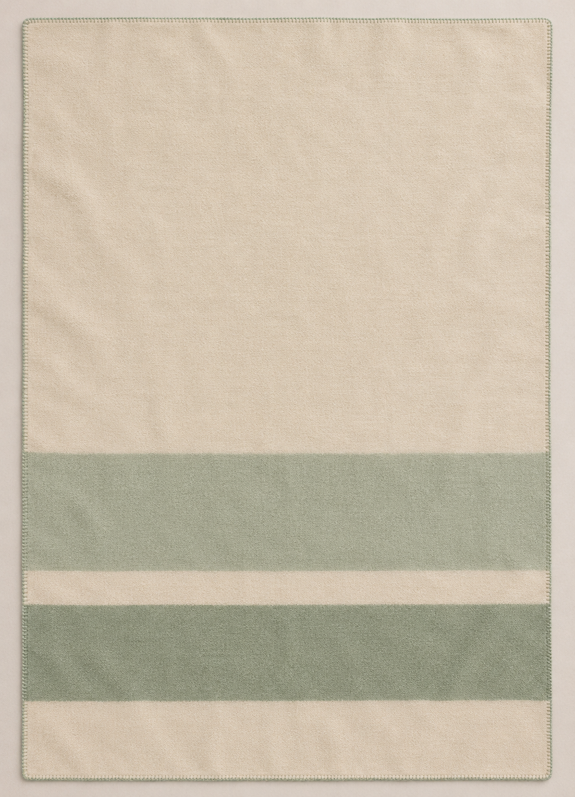
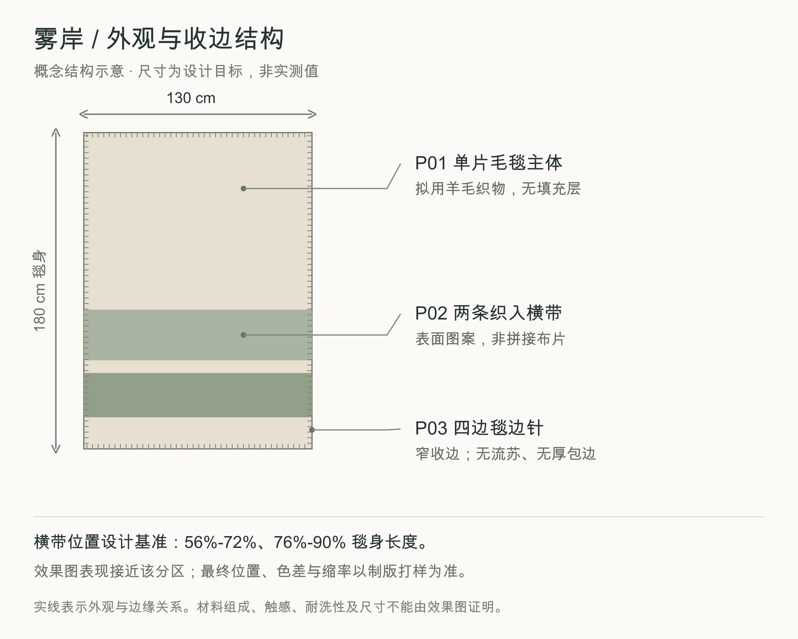
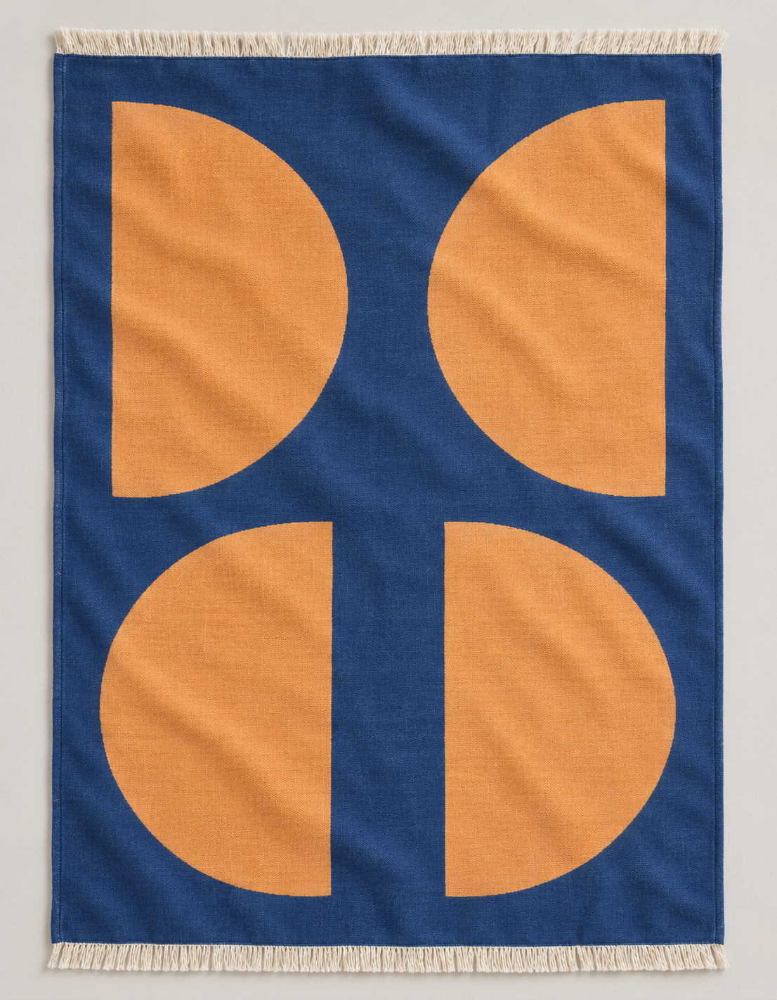
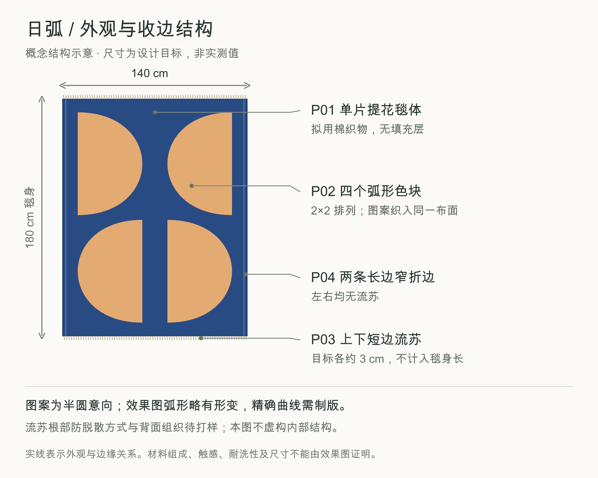

# 毛毯设计提案：雾岸与日弧

日期：2026-11-14。使用 tasteful-product-design Skill；效果图由内置 imagegen 生成，结构图为原创矢量示意。

默认场景：成人居家、沙发披盖与午睡。以下尺寸、材料和色号均是设计目标，非已生产产品参数。

## 雾岸 / MIST SHORE

让织物的触感与低对比节奏成为主角。

- 拟定毯身尺寸：130 × 180 cm。
- 材料与收边：拟用羊毛单片织物；四边毯边针，无流苏。
- 提案色号：#E7DFD0, #A9B3A3, #929F89。

### 两款竞品

| 品牌 / 产品 | Muuto × Aiayu / Rhythm Throw | Frette / Zaira Throw |
| --- | --- | --- |
| 材料（官方） | 100% baby llama wool | 88% 美利奴羊毛；12% 羊绒 |
| 尺寸（官方） | 160 × 130 cm | 130 × 190 cm；是否包含流苏未注明 |
| 表达（官方） | 有节奏的针织结构；强调纱线光泽与肌理 | 提花织造；羊毛与羊绒混纺 |
| 收边证据 | 具体收边工艺未查到 | 短边绞流苏；长边工艺未查到 |
| 本案借鉴（分析） | 以组织肌理建立识别；降低表面装饰密度 | 主体保持安静；把节奏集中在边界与末端 |

### 艺术方向与转译

织物现代主义 / 触觉抽象。MoMA 的 Anni Albers 档案强调通过织物结构、密度与深度形成肌理。本案借鉴这种材料意识，用暖米白底与两条低对比雾绿横带建立秩序，不复刻其作品图案。

组织肌理与末端节奏 → 安静的阅读 / 午睡场景 → 触觉抽象 → 大面积留白、两条织入横带、四边细窄针脚。

本案主动取消流苏，采用四边窄毯边针。横带织入同一毯体，不通过拼接形成；用边缘线色连接两条绿色横带。

### 结构核查

| 编号 | 核查项 | 观察证据 | 结果 |
| --- | --- | --- | --- |
| A-P01 | 毯体与轮廓 | 完整矩形、四角可见；无填充鼓包或可见拼缝 | 外观符合 |
| A-P02 | 横带数量与关系 | 下部两条全宽绿带，中间留米白间隔；第二带更深 | 外观符合 |
| A-P03 | 收边 | 四周连续窄针脚；未见流苏或厚包边 | 外观符合 |
| 尺寸 / 材料 | 物理参数 | 图片不能核实 130×180 cm、真实纤维、克重与精确色值 | 待打样 |
| 背面 / 使用 | 耐用与触感 | 背面未展示；刺痒、起球、缩水及耐洗性未测试 | 待验证 |

本轮结果：未见关键外观矛盾。实际尺寸、精确曲线、真实材质与工艺仍需制版及打样；未展示的背面没有判为已验证。

### 来源

- [Muuto · Rhythm Throw](https://professionals.muuto.com/product/Rhythm-Throw)（访问：2026-11-14）
- [Muuto · 技术资料](https://content.muuto.com/Perfion/File.aspx?action=save&id=90152748-37e8-4844-b5e9-c09d0c442cb9)（访问：2026-11-14）
- [Frette · Zaira Throw](https://eu.frette.com/en_IT/zaira-throw-taupe.html)（访问：2026-11-14）
- [MoMA · Anni Albers 官方档案](https://www.moma.org/momaorg/shared/pdfs/docs/press_archives/1358/releases/MOMA_1949_0072_1949-09-09_490909-66.pdf)（访问：2026-11-14）

[本方案实际生图提示词](concept-a-prompt.txt)

## 日弧 / SUN ARC

把一条日常毛毯变成有节奏的家居色块。

- 拟定毯身尺寸：140 × 180 cm。
- 材料与收边：拟用棉提花单片织物；短边流苏，长边窄折边。
- 提案色号：#294B83, #E3AA72, #E7DFD0。

### 两款竞品

| 品牌 / 产品 | Slowdown Studio / Pierre Throw | Wallace Sewell / Erno Throw |
| --- | --- | --- |
| 材料（官方） | 100% 棉；其中 25% 为回收棉 | 100% 美利奴羔羊毛；织后毡化处理 |
| 尺寸（官方） | 137 × 178 cm | 120 × 170 / 170 × 250 cm；官方注明尺寸可有 ±5% 差异 |
| 表达（官方） | 几何形、色块与斜线；组成碎片化人脸 | 粗野主义建筑启发；深色基调与彩色色块 |
| 收边证据 | 官方图片说明为四边流苏；防脱散工艺未知 | 四边灰色毯边锁针 |
| 本案借鉴（分析） | 大图形形成视觉焦点；保留真实织物颗粒 | 深色基调承接对比色；收边纳入完整构图 |

### 艺术方向与转译

对比色的几何节奏。Cooper Hewitt 的 Sonia Delaunay 资料介绍了相邻对比色形成运动感，以及她在纺织中使用几何、圆形与线条。本案转译为蓝橙配色与四个交替朝向的半圆意向，不沿用竞品人脸或建筑方格。

大图形与深色基调 → 需要空间焦点的客厅 → 对比色几何节奏 → 钴蓝底、四个杏橙弧形块面、仅短边保留本白流苏。

保持单片提花布面，图案不是拼布。上排弧面朝内，下排朝外；蓝色负空间分隔四个图形。仅短边留流苏，让长边维持清楚的矩形边界。

### 结构核查

| 编号 | 核查项 | 观察证据 | 结果 |
| --- | --- | --- | --- |
| B-P01 | 毯体与轮廓 | 单条矩形，四角可见；无可见拼缝或被芯 | 外观符合 |
| B-P02 | 图形数量与方向 | 恰好四个弧形块面，2×2 排列；上内下外、保留蓝色间隙 | 外观符合 |
| B-P03 / P04 | 边缘关系 | 流苏只在上下短边；左右呈窄蓝折边和连续缝线 | 外观符合 |
| 尺寸 / 制版 | 物理参数 | 140×180 cm、约3 cm流苏和精确圆弧未由图像证明 | 待制版 |
| 工艺 / 使用 | 实际性能 | 提花组织、背面、流苏防脱散、掉色与耐洗性未验证 | 待打样 |

本轮结果：未见关键外观矛盾。实际尺寸、精确曲线、真实材质与工艺仍需制版及打样；未展示的背面没有判为已验证。

### 来源

- [Slowdown Studio · Pierre Throw](https://slowdownstudio.com/collections/all/products/pierre-throw)（访问：2026-11-14）
- [Wallace Sewell · Erno Throw](https://wallacesewell.com/products/erno-throw)（访问：2026-11-14）
- [Cooper Hewitt · Sonia Delaunay](https://www.cooperhewitt.org/design-topics/women-in-design/sonia-delaunay/)（访问：2026-11-14）

[本方案实际生图提示词](concept-b-prompt.txt)

## 下一轮打样要核实的内容

两款都需确认尺寸与洗后缩率、纤维成分、克重、触感、起球与色牢度。雾岸另看横带过渡及毯边针张力；日弧另看半圆图案制版、提花背面组织及流苏根部防脱散。当前效果图没有证明这些性能。

竞品描述取自官方资料；舒适度、真实软硬程度等没有作实物结论。未沿用竞品的完整图案、品牌标记或产品名称。
